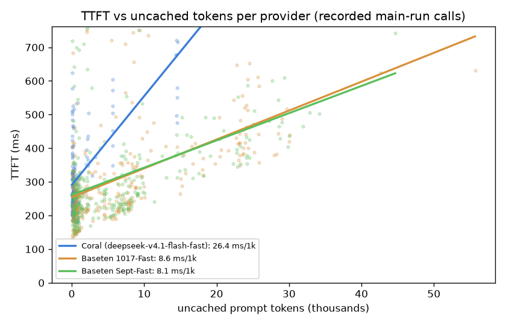
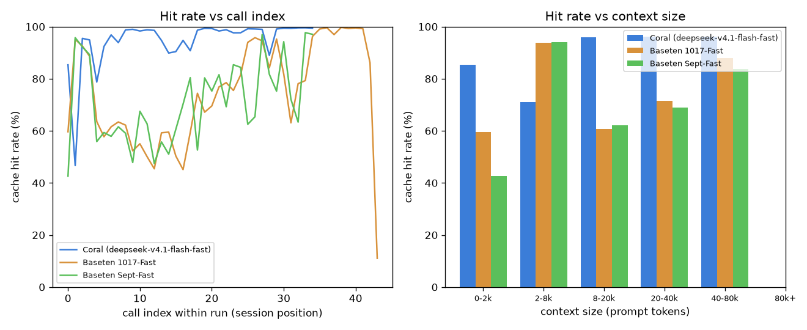

# CACHE_ANALYSIS (Layer A — offline analysis of recorded data)
> **Scope:** bounded to effects on the acceptance loop. Every number here is computed offline from already-recorded data in `results/raw/calls.jsonl` (the pre-registered MAIN EXPERIMENT, windowed to each run's `[wall_start, wall_end]` exactly like `analyze.py`), EXCEPT the Coral network baseline in §2, which is the only new network activity and is **CoralBricks-only by choice** (hard rule: zero Baseten calls).
_Prices as of 2026-11-03. Calls analyzed: 904 (200-only, chat/completions, windowed)._

**Note on replay calls:** `trace_replay.jsonl` persists only per-session aggregates (the proxy's full per-call rows are not written for replays, which bypass the proxy), so the per-call TTFT regression below uses the proxy-recorded main-run calls. Replay session aggregates are used for cross-checking in the final report.

## 1. TTFT vs tokens — per-call regressions per provider
TTFT here is `ttft_s` (request start → first streamed token = network RTT + queue + prefill). Slopes are **ms per 1,000 tokens**; intercept is ms; 95% CIs are bootstrap (5,000 resamples of calls).

| provider | n | model | slope ms/1k **uncached** (CI) | slope ms/1k **cached** (CI) | intercept ms (CI) |
|---|---|---|---|---|---|
| Coral (deepseek-v4.1-flash-fast) | 193 | joint | 25.0 [16.9, 28.9] | -1.93 [-4.06, 0.13] | 339 [277, 409] |
| Baseten 1017-Fast | 303 | joint | 9.3 [7.8, 10.9] | 1.02 [0.12, 1.94] | 231 [202, 262] |
| Baseten Sept-Fast | 282 | joint | 9.0 [7.3, 10.7] | 1.60 [0.22, 2.93] | 228 [194, 265] |

**Separate univariate fits** (each token type alone):

| provider | uncached-only slope (CI) | cached-only slope (CI) | TTFT p50 / p95 (ms) |
|---|---|---|---|
| Coral (deepseek-v4.1-flash-fast) | 26.4 [19.4, 29.6] | -3.81 [-6.24, -1.50] | 270 / 590 |
| Baseten 1017-Fast | 8.6 [7.3, 10.1] | -1.26 [-2.21, -0.31] | 263 / 652 |
| Baseten Sept-Fast | 8.1 [6.7, 9.6] | -0.84 [-2.14, 0.46] | 270 / 634 |

**Reading it:** the uncached slope is the *miss penalty* — extra TTFT per 1k freshly-prefilled tokens. A cached slope near zero (and much smaller than the uncached slope) means cache hits are nearly free in latency, so caching helps the loop, not just the bill.

**Selection caveat (recorded-data artifact, not a new measurement):** the proxy timestamps the first *content*/*reasoning* delta only, so completions that stream **tool-call deltas only** (output tokens but no content/reasoning) have no `ttft_s` and are excluded from these fits. This hits Coral specifically: 126 of 319 Coral 200-calls are tool-call-only (Baseten: 0 / 303; Sept: 0 / 282). So Coral's TTFT fit is over its content-bearing calls; its tool-call turns (which still prefill the prompt) are not represented here. §3/§4 below use ALL 200-calls.

## 2. Network baseline — CORAL ONLY
20× `GET /v1/models` to CoralBricks (1 untimed warmup first): **20/20** OK. Median RTT **138 ms** (p05 84 / p95 306 ms).

Coral recorded TTFT p50 = **270 ms**; network-adjusted (TTFT p50 − median RTT) = **131 ms** of server-side queue+prefill.

**Baseten network-adjusted comparison: UNMEASURED (by choice).** The hard rule forbids any new Baseten call, including `/v1/models`, so we deliberately do not measure Baseten's RTT here. Baseten's recorded TTFT (from the main experiment) is NOT network-adjusted.

## 3. Cache hit rate vs call index and vs context size

| provider | hit@index0 | hit@index5 | hit@index15 | by-context (small→large) |
|---|---|---|---|---|
| Coral (deepseek-v4.1-flash-fast) | 85% | 92% | 90% | 0-2k:85%, 2-8k:71%, 8-20k:96%, 20-40k:96%, 40-80k:96% |
| Baseten 1017-Fast | 60% | 58% | 50% | 0-2k:60%, 2-8k:94%, 8-20k:61%, 20-40k:71%, 40-80k:88% |
| Baseten Sept-Fast | 43% | 59% | 61% | 0-2k:43%, 2-8k:94%, 8-20k:62%, 20-40k:69%, 40-80k:84% |

Index 0 is the first call of a run (cold); hit rate climbs as the session prefix warms. Context-size bins show whether large prompts hit the cache as well as small ones.

## 4. Miss anatomy per provider
Among calls carrying a cacheable prefix (>256 prompt tokens), a *miss* is cached < 90% of the prompt. **Near-total miss** (cached < 10%) ≈ a cold replica / routing miss; **partial tail miss** (10–90% cached) ≈ eviction of the growing tail while the prefix stays warm.

| provider | cacheable calls | misses | near-total (routing) | partial-tail (eviction) | miss rate |
|---|---|---|---|---|---|
| Coral (deepseek-v4.1-flash-fast) | 319 | 40 | 1 | 39 | 12.5% |
| Baseten 1017-Fast | 303 | 176 | 4 | 172 | 58.1% |
| Baseten Sept-Fast | 282 | 164 | 7 | 157 | 58.2% |

**Reading it:** mostly near-total misses point to replica routing (a request landing on a cold replica); mostly partial-tail misses point to the cache holding the prefix but evicting the newest tokens. These imply different mitigations (affinity/routing vs prefix size).
