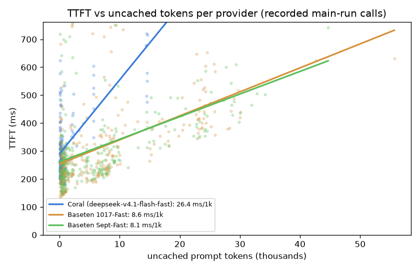
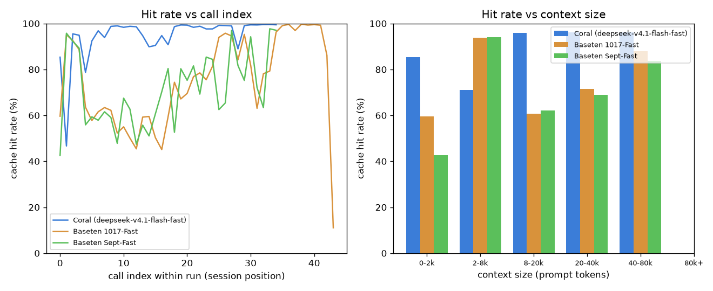
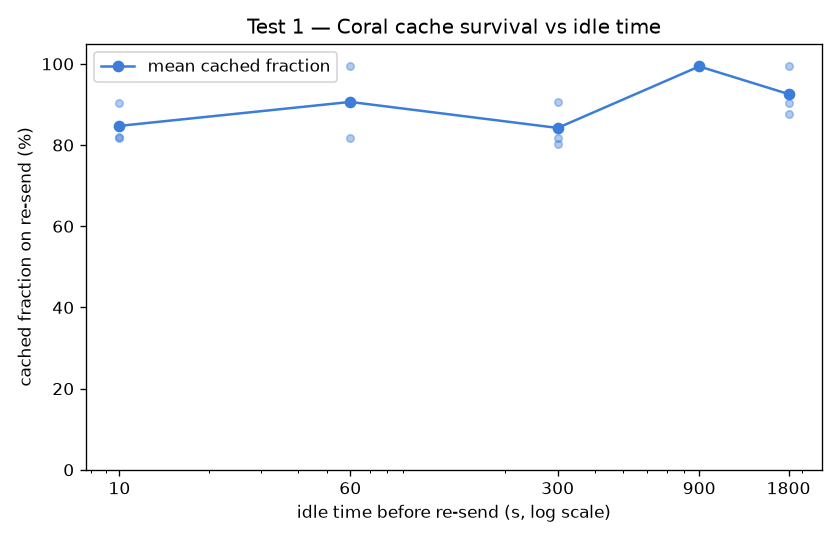
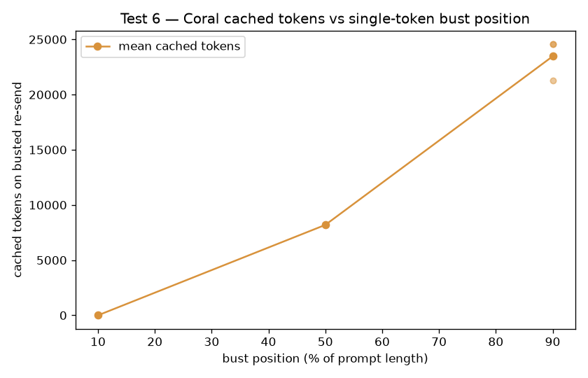

# CACHE_FULL_REPORT — exhaustive caching study (all layers)

> **One consolidated, maximally-detailed report** over the caching extension. Every number is from recorded data: **Layer A** (offline analysis of the main experiment's `results/raw/calls.jsonl`), **Layer B** (Coral-only active probes through the recording proxy), **Layer C** (offline billing reconciliation, no API calls). New active experiments are **CoralBricks-only by choice** (hard rule: zero Baseten calls); Baseten appears only where already recorded. Items not measured are marked **UNMEASURED**. Public prices as of 2026-11-03.

**Companion files:** `CACHE_ANALYSIS.md` (A), `CACHE_SUBEXPERIMENT.md` (B), `BILLING_RECONCILIATION.md` (C), `CACHE_REPORT_SHORT.md` (1-page synthesis), `PREREGISTRATION_CACHE.md`, `DECISION_LOG.md`. Charts in `results/cache_charts/`.

## Contents
1. Methodology & constraints
2. Layer A — TTFT↔token regressions
3. Layer A — Coral network baseline
4. Layer A — hit rate vs index & context
5. Layer A — miss anatomy
6. Layer B — calibration & deviations
7. Layer B — the six cache tests (full per-rep data)
8. Layer C — billing reconciliation
9. Verdict — does caching help the acceptance loop?
10. Reproduction & file manifest

## 1. Methodology & constraints

- **Same proxy + cost accounting.** All Layer-B requests flow through the recording proxy (`proxy/server.py`); cost is `uncached·p_in + cached·p_cached + out·p_out` at public list prices, identical to the main experiment. The Layer-B client sends a **dummy** Authorization; the proxy injects the real Coral key loaded ONLY from `~/code/acceptance-bench/.env`, so the experiment code never reads the secret.
- **Measuring prefill/caching, not generation.** Layer-B sends use `max_tokens=16`, `reasoning_effort=none`, `temperature=0` (`PROXY_INJECT_PARAMS=0`) so output is minimal and the $2.50 budget buys many large prompts.
- **Budget & stop rules.** Hard **$2.50** budget (Layer B spent **$1.0220** over 84 Coral calls; stop reason: `None`). Also stop on ≥3 consecutive 429/5xx or a result contradicting the main experiment (e.g. an immediate resend showing ~0% cache). None triggered.
- **Isolation.** Dedicated `cacheexp-*` run_ids (excluded from the main experiment and from Layer C). Test 1's idle windows run with no other traffic so shared-replica eviction can't confound cache-survival.
- **Coral-only by choice.** ZERO Baseten calls in any layer; Baseten network-adjusted TTFT and Baseten active-cache behavior are UNMEASURED.

## 2. Layer A — TTFT vs tokens (per-call regressions)

Over **904** windowed main-run 200-calls (chat/completions). TTFT = `ttft_s` (request start → first streamed token = network RTT + queue + prefill), in ms. Slopes are **ms per 1,000 tokens**; 95% CIs are bootstrap (5,000 resamples of calls).

### Joint fit (uncached + cached together)

| provider | n | slope ms/1k **uncached** (CI) | slope ms/1k **cached** (CI) | intercept ms (CI) |
|---|---|---|---|---|
| CoralBricks Fast | 193 | 25.0 [16.9, 28.9] | -1.93 [-4.06, 0.13] | 339 [277, 409] |
| Baseten 1017-Fast | 303 | 9.3 [7.8, 10.9] | 1.02 [0.12, 1.94] | 231 [202, 262] |
| Baseten Sept-Fast | 282 | 9.0 [7.3, 10.7] | 1.60 [0.22, 2.93] | 228 [194, 265] |

### Univariate fits (each token type alone) + TTFT percentiles

| provider | uncached-only slope (CI) | cached-only slope (CI) | TTFT p50 | TTFT p95 |
|---|---|---|---|---|
| CoralBricks Fast | 26.4 [19.4, 29.6] | -3.81 [-6.24, -1.50] | 270 ms | 590 ms |
| Baseten 1017-Fast | 8.6 [7.3, 10.1] | -1.26 [-2.21, -0.31] | 263 ms | 652 ms |
| Baseten Sept-Fast | 8.1 [6.7, 9.6] | -0.84 [-2.14, 0.46] | 270 ms | 634 ms |

**Reading it.** A cached token adds ≈0 ms of TTFT on all three arms (Coral slightly negative); an uncached token adds 9–25 ms per 1k. The miss penalty is what you pay — and Coral's is the steepest, so its high hit rate matters most.

**Selection caveat.** The proxy timestamps the first content/reasoning delta only, so tool-call-only completions (output tokens, no content/reasoning) have no TTFT and are excluded: Coral 126/319 calls are tool-call-only (Baseten 0/303, Sept 0/282). §4/§5 use all 200-calls.



## 3. Layer A — Coral network baseline (CORAL ONLY)

20× `GET /v1/models` to Coral (20/20 OK, one untimed warmup first): **median RTT 138 ms** (p05 84 / p95 306 ms). Coral TTFT p50 270 ms − RTT = **131 ms** server-side queue+prefill.

**Baseten network-adjusted TTFT: UNMEASURED (by choice)** — the hard rule forbids any new Baseten call, including `/v1/models`.

## 4. Layer A — cache hit rate vs call index & context size



Hit rate = cached/prompt, averaged across runs. Index 0 = first (cold) call of a run.

| provider | idx 0 | idx 5 | idx 15 | by context (prompt tokens) |
|---|---|---|---|---|
| CoralBricks Fast | 85% | 92% | 90% | 0-2k:85%(n=10), 2-8k:71%(n=20), 8-20k:96%(n=123), 20-40k:96%(n=134), 40-80k:96%(n=32) |
| Baseten 1017-Fast | 60% | 58% | 50% | 0-2k:60%(n=10), 2-8k:94%(n=20), 8-20k:61%(n=108), 20-40k:71%(n=144), 40-80k:88%(n=21) |
| Baseten Sept-Fast | 43% | 59% | 61% | 0-2k:43%(n=10), 2-8k:94%(n=20), 8-20k:62%(n=105), 20-40k:69%(n=121), 40-80k:84%(n=26) |

## 5. Layer A — miss anatomy

Among calls with a cacheable prefix (>256 prompt tokens), a *miss* is cached < 90% of the prompt. **Near-total** (cached < 10%) ≈ cold-replica routing; **partial-tail** (10–90%) ≈ eviction of the growing tail.

| provider | cacheable calls | misses | near-total (routing) | partial-tail (eviction) | miss rate |
|---|---|---|---|---|---|
| CoralBricks Fast | 319 | 40 | 1 | 39 | 12.5% |
| Baseten 1017-Fast | 303 | 176 | 4 | 172 | 58.1% |
| Baseten Sept-Fast | 282 | 164 | 7 | 157 | 58.2% |

Both providers' misses are **eviction-dominated**, not routing: the prefix stays warm while the newest tokens get re-prefilled.

## 6. Layer B — calibration & deviations (Coral-only)

- **Calibration:** 3.29 chars/token (synthetic code-like text ported from `coral-probe` `textgen`).
- **Sanity (measurement-bug guard):** an immediate identical resend of a fresh ~30k prompt cached **79%** (threshold 0.5; the main experiment's ~96% is a many-warm-call average). Passed → no stop.
- **Deviation (logged):** the Coral account caps in-flight requests at **5** (an 8-way fan-out returned HTTP 429). A global semaphore holds all parallel sections at ≤5 and 429/5xx retries with backoff; fan-out width is **5**, not the pre-registered 8. Lifting the cap needs account credit (out of scope; still Coral-only).

## 7. Layer B — the six cache tests (full per-rep data)

### Test 1 — Review delay (cache survival vs idle)



Unique ~30k prefix per (gap, rep); prime, idle, re-send; 3 reps/gap; gaps run in parallel. Cached fraction = cached/prompt on the re-send.

| idle before re-send | mean cached fraction | per-rep |
|---|---|---|
| 10s | 85% | 82%, 82%, 90% |
| 60s | 91% | 100%, 91%, 82% |
| 300s | 84% | 91%, 82%, 80% |
| 900s | 99% | 99%, 99%, 100% |
| 1800s | 93% | 100%, 90%, 88% |

**Finding:** flat at 84–99% with no decay out to 30 minutes — Coral's prefix cache survives a human review pause; the next turn does not re-prefill.

### Test 2 — Context growth (hit vs miss TTFT by size)

Prefix sizes ~20k/100k/300k, 3 reps each; send once (miss) then re-send (hit).

| prompt size | status | miss TTFT p50 | hit TTFT p50 | hit cached frac | actual prompt tok |
|---|---|---|---|---|---|
| ~20k | ok | 0.74s | 0.30s | 81% | 20057 |
| ~100k | ok | 2.03s | 0.45s | 97% | 99968 |
| ~300k | ok | 4.62s | 0.91s | 100% | 300905 |

**Finding:** the miss penalty grows with context (0.74→4.62s from 20k→300k) while a hit stays sub-second — so the cache's latency win **widens** with prompt size. **300k context works** (no context-limit error).

### Test 3 — Warm fan-out

Prime a ~30k prefix (prime cached 0%), then 5 concurrent requests share it. Per-request cached fraction: 99%, 82%, 99%, 99%, 99%.

- **Mean hit rate: 95%.** TTFT min/median/max = 0.29 / 0.82 / 0.83 s.
- A warmed prefix fully absorbs concurrent fan-out.

### Test 4 — Cold fan-out

5 concurrent identical requests on a NEW unprimed ~30k prefix (no prime). Per-request cached fraction: 0%, 85%, 97%, 0%, 82%; TTFT (s): 1.06, 1.24, 1.24, 0.75, 0.81.

- **3/5 requests shared a prefill** (cached>50%). Concurrent cold requests **partially in-flight-dedup** — the first to prefill warms the rest — rather than each prefilling independently.

### Test 5 — Branch / rollback

10-turn conversation (~3k tok/turn, fixed assistant stubs so the transcript is deterministic and cacheable), then branch from turn 5 with a different turn-6 message.

- Shared 5-turn prefix ≈ **15243 tokens**.
- Branch: cached **15104 / 18305** prompt tokens (83%).
- **Finding:** cached ≈ the shared prefix → the cache keeps the common ancestor when a conversation branches; a rollback/retry re-prefills only the divergent tail, not the whole history.

### Test 6 — Prefix-bust position



Change one token at 10%/50%/90% of a cached ~30k prompt (fresh base per rep), 3 reps each.

| bust position | mean cached tokens | per-rep cached tokens |
|---|---|---|
| 10% of length | 0 | 0, 0, 0 |
| 50% of length | 8192 | 8192, 8192, 8192 |
| 90% of length | 23467 | 24576, 21248, 24576 |

**256-block granularity:** nonzero cached counts are **exactly 256-aligned** (6/6 within 32 of a 256 multiple; residuals mod 256 = [0, 0, 0, 0, 0, 0]), clustering at multiples of **8192 (=32×256)**: 8192 at 50%, 24576 (=3×8192) at 90%.

**Finding:** cached tokens are **not** proportional to bust position — a 10% bust drops the cache to 0, 50% keeps one 8192 block, 90% keeps three. An **early edit re-prefills far more than its position implies**; the cache retains whole 256-aligned blocks before the first changed token.

## 8. Layer C — billing reconciliation (no API calls)

Proxy-recorded cost+tokens, deduplicated across the live `calls.jsonl` + 3 archived snapshots by (provider, timestamp, run_id, round, call_index); `cacheexp-*` excluded; replays folded in from `trace_replay.jsonl` (they bypassed the proxy). Compared to the provider dashboards.

### Baseten 1017-Fast  (`baseten`)

| bucket | calls | uncached | cached | output | cost |
|---|---|---|---|---|---|
| pilot + earlier/aborted (pre-main) | 286 | 2.318M | 6.210M | 101.0K | $1.7200 |
| main | 303 | 2.098M | 5.479M | 107.0K | $1.5920 |
| probes | 51 | 0.235M | 0.099M | 9.9K | $0.1663 |
| smoke/preflight | 10 | 0.058M | 0.000M | 0.3K | $0.0358 |
| stale (outside window) | 14 | 0.160M | 0.321M | 4.9K | $0.1123 |
| replay (direct) | 205 (6 sess) | 1.767M | 3.727M | 64.0K | $1.2658 |
| **our recorded total** | **869** | **6.636M** | **15.835M** | **287.1K** | **$4.8922** |
| **provider dashboard** | — | **6.730M** | **16.000M** | **287.6K** | **$4.95** |
| **unexplained remainder** | — | 0.094M | 0.165M | 0.5K | $0.06 |

_Recorded spend = **99%** of the $4.95 dashboard._

### Baseten Sept-Fast  (`baseten_sept`)

| bucket | calls | uncached | cached | output | cost |
|---|---|---|---|---|---|
| pilot + earlier/aborted (pre-main) | 176 | 1.307M | 2.809M | 69.6K | $0.9904 |
| main | 282 | 1.989M | 4.778M | 91.4K | $1.4798 |
| replay (direct) | 205 (6 sess) | 1.228M | 4.265M | 73.0K | $0.9719 |
| **our recorded total** | **663** | **4.524M** | **11.852M** | **234.0K** | **$3.4421** |
| **provider dashboard** | — | **4.562M** | **12.236M** | **236.7K** | **$3.48** |
| **unexplained remainder** | — | 0.038M | 0.384M | 2.7K | $0.04 |

_Recorded spend = **99%** of the $3.48 dashboard._

### Coral  (`coral`)

| bucket | calls | uncached | cached | output | cost |
|---|---|---|---|---|---|
| pilot + earlier/aborted (pre-main) | 241 | 0.229M | 5.007M | 94.1K | $0.3175 |
| main | 319 | 0.318M | 7.405M | 127.7K | $0.4396 |
| probes | 48 | 0.048M | 0.232M | 8.8K | $0.0395 |
| smoke/preflight | 10 | 0.017M | 0.041M | 0.3K | $0.0086 |
| replay (direct) | 205 (6 sess) | 0.031M | 5.462M | 72.3K | $0.1934 |
| **our recorded total** | **823** | **0.644M** | **18.146M** | **303.2K** | **$0.9987** |
| **provider dashboard** | — | **0.800M** | **23.500M** | **370.5K** | **$1.25** |
| **unexplained remainder** | — | 0.156M | 5.354M | 67.3K | $0.25 |

_Recorded spend = **80%** of the $1.25 dashboard._

**Remainder attribution:** direct probes that bypassed the proxy (Baseten cache deep-dive, affinity/multi-slug probes, billing checks); **prior use of the same Coral account by the earlier `coral-probe` project** (the main driver of Coral's ~5.35M unexplained cached tokens); dashboard token semantics (cache-write/aborted counted differently); aggregation lag. Reported as-is, never forced to zero.

## 9. Verdict — does caching help the acceptance loop (beyond cost)?

**Yes — the help is latency, not just dollars.** The acceptance loop re-sends a large, slowly-growing context every turn. A cache hit costs ≈0 ms of TTFT while a miss costs 9–25 ms per 1k uncached tokens, so on a ~30k-token prompt caching is the difference between a sub-second first token and a multi-second prefill (hit vs miss TTFT: 0.30s vs 0.74s at 20k, widening to 0.91s vs 4.62s at 300k). That benefit is **durable** (survives a 30-min review pause), **branch-friendly** (a rollback keeps the shared ancestor), and **concurrency-friendly** (a warmed prefix absorbs fan-out at 95% hit). The two fragilities for a coding agent are (a) an **early edit** near the prompt head, which re-prefills far more than its position suggests because the cache quantizes to 256-aligned blocks, and (b) Coral's comparatively **steep per-token miss penalty**, which makes its high hit rate (12.5% miss vs Baseten's ~58%) the thing buying the loop its speed. Keeping edits append-only (not rewriting the prompt head) is how an agent keeps the benefit. _All active conclusions are Coral-only by choice; the equivalent Baseten network-adjusted and active-cache behavior is UNMEASURED._

## 10. Reproduction & file manifest

```
python -m harness.cache_analysis        # Layer A (+ 20 Coral /v1/models pings)
python -m harness.cache_subexperiment   # Layer B (Coral-only, ~30 min, <$2.50)
python -m harness.billing_reconciliation# Layer C (offline, no API calls)
python -m harness.build_cache_report    # this report + site/caching.html
python -m http.server 8000              # then open /site/caching.html
```

| file | what |
|---|---|
| `PREREGISTRATION_CACHE.md` | Layer-B design, locked before any call |
| `results/CACHE_ANALYSIS.md` | Layer A |
| `results/CACHE_SUBEXPERIMENT.md` | Layer B |
| `results/BILLING_RECONCILIATION.md` | Layer C |
| `results/CACHE_REPORT_SHORT.md` | 1-page synthesis |
| `results/CACHE_FULL_REPORT.md` | this file |
| `site/caching.html` | web version (charts embedded) |
| `results/cache_charts/*.png` | 4 charts |
| `SERIES_NOTES.md` | deferred future episodes |

_Constraints honored: zero Baseten API calls in any layer; main results / SUMMARY.md / PREREGISTRATION.md untouched; only new files written; Coral key read only from `.env`; every number from recorded data._
