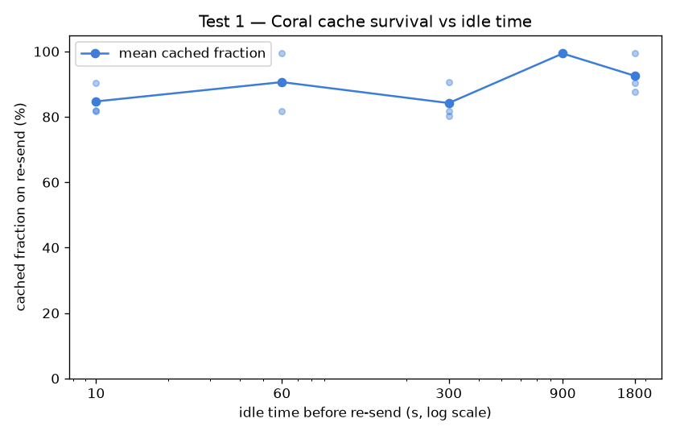
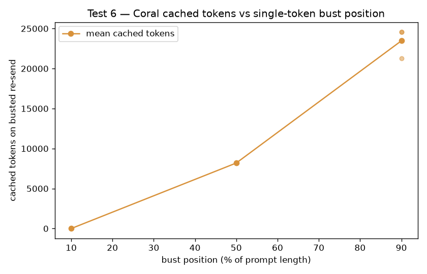

# CACHE_SUBEXPERIMENT (Layer B — CoralBricks ONLY)
> **All conclusions below are Coral-only by choice** (hard rule: zero Baseten calls). Pre-registered in `PREREGISTRATION_CACHE.md`. Requests flowed through the recording proxy; cost uses the same public-price accounting as the main experiment. Prices as of 2026-11-03.

**Spend: $1.0220 / $2.50 budget** over 84 Coral calls. Stop reason: `None`.

**Logged deviation from pre-registration:** the Coral account caps in-flight requests at **5** (empirically: an 8-way fan-out returned HTTP 429 "this account may have 5 in flight at once"). A global semaphore holds all parallel sections at ≤5, and the fan-out tests (3 & 4) use width **5** instead of the pre-registered 8. Adding account credit to lift the cap was out of scope (and would still be Coral-only). All other parameters are as pre-registered.

_Calibration: 3.29 chars/token; immediate-resend sanity cached fraction 79% (main experiment ~96%, so the cache path is behaving)._

## Test 1 — Review delay (cache survival vs idle)

| idle before re-send | mean cached fraction | per-rep |
|---|---|---|
| 10s | 85% | 82%, 82%, 90% |
| 60s | 91% | 100%, 91%, 82% |
| 300s | 84% | 91%, 82%, 80% |
| 900s | 99% | 99%, 99%, 100% |
| 1800s | 93% | 100%, 90%, 88% |

_Unique ~30k prefix per (gap, rep); 3 reps/gap, gaps run in parallel. Cached fraction is cached/prompt on the re-send._

## Test 2 — Context growth (hit vs miss TTFT by size)
| prompt size | status | miss TTFT (p50) | hit TTFT (p50) | hit cached frac | actual prompt tok |
|---|---|---|---|---|---|
| ~20k | ok | 0.74 | 0.30 | 81% | 20057 |
| ~100k | ok | 2.03 | 0.45 | 97% | 99968 |
| ~300k | ok | 4.62 | 0.91 | 100% | 300905 |

## Test 3 — Warm fan-out (concurrent requests sharing a primed prefix)
- Prime cached fraction: 0%; then 5 concurrent.
- **Mean hit rate across the 5: 95%.** TTFT min/med/max = 0.29 / 0.82 / 0.83 s.

## Test 4 — Cold fan-out (concurrent requests on a NEW unprimed prefix)
- **3/5 requests shared a prefill** (cached > 50%).
- Per-request cached fraction: 0%, 85%, 97%, 0%, 82%.
- Interpretation: if only 0–1 share, concurrent cold requests each prefill independently (no in-flight dedup); if most share, the first to finish warms a prefix the rest reuse.

## Test 5 — Branch / rollback
- Built 10 turns (~3k tok each). Shared 5-turn prefix ≈ **15243 tokens**.
- Branch from turn 5 (different turn-6 message): cached **15104 / 18305** prompt tokens (83%).
- Interpretation: cached ≈ the shared prefix means the cache keeps the common ancestor when a conversation branches (rollback is cheap); only the divergent tail re-prefills.

## Test 6 — Prefix-bust position

| bust position | mean cached tokens | per-rep cached |
|---|---|---|
| 10% of length | 0 | 0, 0, 0 |
| 50% of length | 8192 | 8192, 8192, 8192 |
| 90% of length | 23467 | 24576, 21248, 24576 |

_256-token block granularity check (nonzero cached counts, i.e. excluding the all-missed 10% busts): 6/6 fall within 32 tokens of a 256 multiple (residuals mod 256: [0, 0, 0, 0, 0, 0]) → cached counts are **exactly 256-aligned**. The observed values cluster at multiples of **8192** (= 32×256): 8192 at 50%, 24576 (=3×8192) at 90%._

_**Finding:** cached tokens are NOT proportional to bust position. A bust at 10% drops the cache to **0** (the retained prefix falls below the first block boundary); 50% retains one 8192 block; 90% retains three. So an early edit re-prefills far more than its position implies, and the cache keeps whole 256-aligned (here 8192-quantized) blocks before the first changed token._
