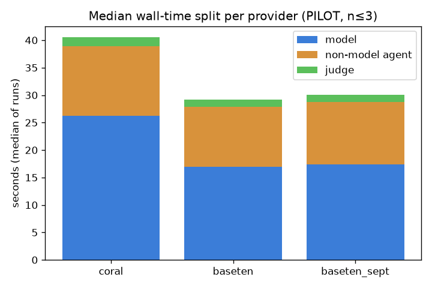

# Main experiment — CoralBricks vs Baseten (ACCEPTED-work benchmark)
> ## PRE-REGISTERED MAIN EXPERIMENT — n=10 per arm, 3 arms.
> Pre-registered in PREREGISTRATION.md (committed before any main run). Paired bootstrap 95% CIs below. Still a single task on a single machine — CIs quantify run-to-run variance, NOT external validity. Read the limitations section.

## Run order (recorded)
- seed: `20261103`
- order: `['baseten', 'baseten_sept', 'coral', 'baseten', 'baseten_sept', 'coral', 'baseten', 'baseten_sept', 'coral', 'baseten_sept', 'baseten', 'coral', 'baseten', 'coral', 'baseten_sept', 'baseten_sept', 'baseten', 'coral', 'baseten_sept', 'baseten', 'coral', 'baseten', 'coral', 'baseten_sept', 'coral', 'baseten_sept', 'baseten', 'coral', 'baseten_sept', 'baseten']`
- caps: `{"max_rounds": 6, "max_round_s": 600, "max_run_s": 1500, "spend_cap_usd": 18.0}`
- identical settings both arms: `{"temperature": 0.0, "max_tokens": 8192, "reasoning_effort": "high"}`

## Per-run table
| run | provider | outcome | rounds | wall s | model s | non-model agent s | judge s | f=model/wall | calls | uncached | cached | output | cache hit | cost $ | 429 | 529 | 5xx |
|---|---|---|---|---|---|---|---|---|---|---|---|---|---|---|---|---|---|
| run00_baseten | baseten | accepted | 2 | 41.37 | 25.38 | 14.62 | 1.26 | 0.61 | 44 | 356806 | 1179904 | 13975 | 76.8% | 0.2641 | 0 | 0 | 0 |
| run01_baseten_sept | baseten_sept | accepted | 2 | 36.79 | 21.81 | 13.50 | 1.36 | 0.59 | 34 | 220333 | 760320 | 14924 | 77.5% | 0.1787 | 0 | 0 | 0 |
| run02_coral | coral | accepted | 3 | 53.10 | 36.61 | 14.47 | 1.85 | 0.69 | 35 | 27525 | 908800 | 15144 | 97.1% | 0.0478 | 0 | 0 | 0 |
| run03_baseten | baseten | accepted | 2 | 30.82 | 15.66 | 13.67 | 1.38 | 0.51 | 35 | 268967 | 606464 | 8923 | 69.3% | 0.1913 | 0 | 0 | 0 |
| run04_baseten_sept | baseten_sept | accepted | 2 | 24.72 | 13.78 | 9.62 | 1.21 | 0.56 | 23 | 177844 | 322560 | 8305 | 64.5% | 0.1312 | 0 | 0 | 0 |
| run05_coral | coral | accepted | 2 | 37.08 | 25.21 | 10.29 | 1.44 | 0.68 | 28 | 10622 | 489472 | 12770 | 97.9% | 0.0322 | 0 | 0 | 0 |
| run06_baseten | baseten | accepted | 2 | 31.54 | 19.05 | 11.03 | 1.33 | 0.60 | 28 | 179867 | 517376 | 11510 | 74.2% | 0.1428 | 0 | 0 | 0 |
| run07_baseten_sept | baseten_sept | accepted | 2 | 36.28 | 21.70 | 13.07 | 1.37 | 0.60 | 35 | 317843 | 672000 | 10677 | 67.9% | 0.2257 | 0 | 0 | 0 |
| run08_coral | coral | accepted | 3 | 39.12 | 22.96 | 14.03 | 1.93 | 0.59 | 35 | 28765 | 918784 | 10734 | 97.0% | 0.0405 | 0 | 0 | 0 |
| run09_baseten_sept | baseten_sept | accepted | 1 | 28.94 | 19.13 | 9.02 | 0.72 | 0.66 | 26 | 166101 | 283648 | 9821 | 63.1% | 0.1272 | 0 | 0 | 0 |
| run10_baseten | baseten | accepted | 2 | 27.66 | 15.37 | 10.87 | 1.28 | 0.56 | 26 | 172294 | 428800 | 8442 | 71.3% | 0.1296 | 0 | 0 | 0 |
| run11_coral | coral | accepted | 3 | 44.85 | 29.39 | 13.34 | 1.90 | 0.66 | 33 | 73975 | 786944 | 12549 | 91.4% | 0.0630 | 0 | 0 | 0 |
| run12_baseten | baseten | accepted | 2 | 29.28 | 17.73 | 10.02 | 1.38 | 0.61 | 24 | 103437 | 318208 | 12244 | 75.5% | 0.0959 | 0 | 0 | 0 |
| run13_coral | coral | accepted | 2 | 34.43 | 21.01 | 12.02 | 1.24 | 0.61 | 30 | 32115 | 664320 | 9594 | 95.4% | 0.0377 | 0 | 0 | 0 |
| run14_baseten_sept | baseten_sept | accepted | 1 | 32.02 | 19.25 | 11.97 | 0.70 | 0.60 | 31 | 171570 | 667392 | 9673 | 79.5% | 0.1355 | 0 | 0 | 0 |
| run15_baseten_sept | baseten_sept | accepted | 2 | 29.20 | 13.99 | 13.77 | 1.27 | 0.48 | 33 | 221847 | 544768 | 7908 | 71.1% | 0.1597 | 0 | 0 | 0 |
| run16_baseten | baseten | accepted | 2 | 30.88 | 16.86 | 12.60 | 1.25 | 0.55 | 31 | 232649 | 581120 | 10694 | 71.4% | 0.1734 | 0 | 0 | 0 |
| run17_coral | coral | accepted | 3 | 39.23 | 24.51 | 12.54 | 1.90 | 0.62 | 31 | 32045 | 726016 | 11959 | 95.8% | 0.0425 | 0 | 0 | 0 |
| run18_baseten_sept | baseten_sept | accepted | 2 | 27.92 | 15.72 | 10.72 | 1.29 | 0.56 | 25 | 186559 | 368384 | 7695 | 66.4% | 0.1356 | 0 | 0 | 0 |
| run19_baseten | baseten | accepted | 2 | 31.12 | 16.94 | 12.69 | 1.31 | 0.54 | 31 | 174094 | 546816 | 10154 | 75.9% | 0.1365 | 0 | 0 | 0 |
| run20_coral | coral | accepted | 2 | 41.22 | 26.96 | 12.74 | 1.31 | 0.65 | 33 | 29816 | 809728 | 11960 | 96.4% | 0.0422 | 0 | 0 | 0 |
| run21_baseten | baseten | accepted | 2 | 25.18 | 15.08 | 8.67 | 1.24 | 0.60 | 23 | 160896 | 219136 | 10792 | 57.7% | 0.1255 | 0 | 0 | 0 |
| run22_coral | coral | accepted | 2 | 43.84 | 29.84 | 12.56 | 1.23 | 0.68 | 31 | 31324 | 788736 | 15771 | 96.2% | 0.0496 | 0 | 0 | 0 |
| run23_baseten_sept | baseten_sept | accepted | 3 | 35.96 | 19.85 | 13.75 | 2.01 | 0.55 | 32 | 211513 | 581888 | 9436 | 73.3% | 0.1577 | 0 | 0 | 0 |
| run24_coral | coral | accepted | 2 | 40.36 | 25.53 | 13.38 | 1.23 | 0.63 | 33 | 32215 | 789248 | 11681 | 96.1% | 0.0426 | 0 | 0 | 0 |
| run25_baseten_sept | baseten_sept | accepted | 2 | 22.98 | 14.71 | 6.63 | 1.47 | 0.64 | 21 | 146820 | 291840 | 7045 | 66.5% | 0.1091 | 0 | 0 | 0 |
| run26_baseten | baseten | accepted | 2 | 30.51 | 19.17 | 9.86 | 1.29 | 0.63 | 32 | 228122 | 578304 | 9816 | 71.7% | 0.1685 | 0 | 0 | 0 |
| run27_coral | coral | accepted | 3 | 39.77 | 29.80 | 7.89 | 1.81 | 0.75 | 30 | 19495 | 522496 | 15573 | 96.4% | 0.0415 | 0 | 0 | 0 |
| run28_baseten_sept | baseten_sept | accepted | 2 | 20.86 | 13.12 | 6.32 | 1.25 | 0.63 | 22 | 168744 | 284928 | 5948 | 62.8% | 0.1195 | 0 | 0 | 0 |
| run29_baseten | baseten | accepted | 2 | 26.42 | 16.77 | 8.26 | 1.21 | 0.63 | 29 | 220520 | 503040 | 10408 | 69.5% | 0.1643 | 0 | 0 | 0 |

*model s = union of API call intervals (proxy clock). non-model agent s = agent phase time − model s. 'other' overhead (git/copy) = wall − agent − judge.*

## Per-provider summary
| metric | coral | baseten | baseten_sept |
|---|---|---|---|
| runs | 10 | 10 | 10 |
| accepted | 10 | 10 | 10 |
| wall median (s) | 40.07 | 30.66 | 29.07 |
| time per ACCEPTED result (s) | 41.30 | 30.48 | 29.57 |
| cost per ACCEPTED result ($) | 0.0440 | 0.1592 | 0.1480 |
| median rounds | 2.5 | 2.0 | 2.0 |
| TTFT p50 (s) | 0.270 | 0.263 | 0.270 |
| TTFT p95 (s) | 0.590 | 0.652 | 0.634 |
| decode tok/s p50 [UNRELIABLE — see Diagnostics] | 1410.0 | 2312.4 | 2487.7 |
| cache hit rate | 95.9% | 72.3% | 70.6% |
| total cost ($) — primary (w/ cache discount) | 0.4396 | 1.5920 | 1.4798 |
| total cost ($) — NO cache discount (worst-case) | 3.7050 | 4.8028 | 4.2796 |
| speculative acceptance | — | 0.657 | 0.681 |

*time/cost per ACCEPTED = (Σ that arm's runs' wall/cost) ÷ (#accepted); '—' if 0 accepted. Primary cost = public prices w/ cache discount on response `cached_tokens` (billing-verified in the pilot).*

## Bootstrap 95% CIs (pre-registered; paired by time slot)
_10000 resamples of 10 time-slot groups; 95% percentile CIs._

| quantity | coral | baseten | baseten_sept |
|---|---|---|---|
| time/accepted 95% CI (s) | [38.6, 44.5] | [28.2, 33.3] | [26.2, 32.9] |
| cost/accepted 95% CI ($) | [$0.0396, $0.0491] | [$0.1347, $0.1882] | [$0.1300, $0.1700] |

**Paired differences (CI excluding 0 ⇒ robust direction at this n):**
- A−B (coral−baseten): Δtime/accepted [8.4, 13.5] s (excludes 0); Δcost/accepted [$-0.1445, $-0.0892] (excludes 0).
- B−C (baseten−baseten_sept): Δtime/accepted [-2.7, 4.0] s (includes 0); Δcost/accepted [$-0.0202, $0.0408] (includes 0).

## Amdahl check (coral vs baseten-1017)
*(Uses controlled-probe decode speeds, not the unreliable per-call decode.)*
- Per-call model-throughput speedup (coral decode p50 / baseten decode p50): **0.60×**
- Model share of wall on baseline (baseten), f (median): **0.60**
- Amdahl-predicted end-to-end speedup `1/((1-f)+f/s)`: **0.72×**
- Observed end-to-end speedup (baseten median wall / coral median wall): **0.77×**

  (Interpretation: if observed ≪ predicted, faster decode did not translate into faster ACCEPTED work because non-model agent + judge time dominate.)

## Recorded observations (n=10 per arm — descriptive; see CIs above)
- acceptance: coral 10/10, baseten 10/10, baseten_sept 10/10
- faster to ACCEPTED (time/accepted): **baseten_sept** (coral 41.3, baseten 30.5, baseten_sept 29.6)
- cheaper per ACCEPTED (primary cost): **coral** (coral $0.0440, baseten $0.1592, baseten_sept $0.1480)
- higher cache hit rate: **coral** (coral 95.9%, baseten 72.3%, baseten_sept 70.6%)
- faster decode (controlled probe tok/s): **baseten** (coral 389, baseten 646)

## Trace replay (inference isolated from agent behavior)
Same request sequences (6 captured sessions) replayed against each arm with original inter-call gaps and a fresh affinity id per replay — isolates inference speed + caching from agent behavior.

| metric (median over sessions) | coral | baseten | baseten_sept |
|---|---|---|---|
| model time / session (s) | 40.37 | 26.53 | 24.07 |
| cache hit rate | 99.5% | 71.1% | 78.2% |
| cost / session ($) | $0.0309 | $0.2058 | $0.1601 |
| TTFT content p50 (s) | 0.958 | 0.475 | 0.443 |
| content decode total (s) | 0.30 | 0.14 | 0.08 |

*Identical input per arm, so differences here are provider inference + caching only, with agent behavior held fixed. Compare to the main experiment, where each arm's agent did DIFFERENT work (Coral ~38% more reasoning).*

## Diagnostics (post-pilot, from harness/pilot_diagnostics.py)
### 1. Decode-speed validity
- **Both providers stream reasoning deltas**, and the proxy timestamps them, so with `reasoning_effort=high` the pilot `decode_s` is contaminated by reasoning bursts. The per-call pilot decode tok/s is therefore **unreliable** (over calls with ≥200 visible output tokens the p95 explodes):
  - coral: incl-reasoning p50 3325 / p95 249221 tok/s; visible-only p50 2612 tok/s (n=55 qualifying calls)
  - baseten: incl-reasoning p50 9264 / p95 1048625 tok/s; visible-only p50 8351 tok/s (n=48 qualifying calls)

### 2. Controlled long-generation probe (authoritative decode)
- Same prompt, ~750 output tokens, `reasoning_effort=none` (0 reasoning tokens), 5 reps:
  - **coral: 389 tok/s** (median output 684 tok, 2.05 tokens/content-chunk, reasoning streamed: False)
  - **baseten: 646 tok/s** (median output 803 tok, 1.94 tokens/content-chunk, reasoning streamed: False)
  - → Baseten decodes **1.66× faster** than Coral on clean long generation (directionally same as the pilot's crude number, but far smaller magnitude).

### 3. Speed vs rounds (per provider)
| metric | coral | baseten |
|---|---|---|
| agent time / round p50 (s) | 9.392 | 13.721 |
| agent time / round p95 (s) | 33.579 | 24.392 |
| model latency / call p50 (s) | 0.503 | 0.438 |
| model latency / call p95 (s) | 2.919 | 1.468 |
| OpenCode startup / round p50 (s) | 0.836 | 0.712 |

### 4. Cost decomposition (why the cost gap?)
- cost gap (baseten − coral): **$1.1524**
- **price effect: $0.4062 (35%)** — Baseten's higher unit prices.
- **token/cache effect: $0.7462 (65%)** — Baseten billed far more uncached input (lower cache hit). This DOMINATES the gap.
- tokens: coral uncached=317897 cached=7404544; baseten uncached=2097652 cached=5479168
- Baseten's tokens priced at Coral's rates = $1.1858 (vs coral's own $0.4396): still higher, confirming token/cache behavior is the bigger driver than price.

### 5. Cache misses — session-start vs mid-session
- coral: hit rate all calls 95.9%, excluding each run's first call 95.9% (first calls = 0.28% of uncached).
- baseten: hit rate all calls 72.3%, excluding each run's first call 72.3% (first calls = 0.12% of uncached).
- → Baseten's lower hit rate is **not** a cold-start artifact; it is pervasive mid-session. First calls are a negligible share of uncached tokens on both arms.

## Time decomposition chart

## Proxy overhead (measured)
- 20 identical tiny requests, direct vs through the proxy (offline mock upstream).
- direct median **9.231 ms**, proxy median **11.465 ms** → **2.234 ms** median added latency per call.

## Preflight notes
- preflight result: `completed (review output; operator go-ahead required for pilot)`
- coral: cached tokens 1st=4352 2nd=4352 (cache grew: False)
- baseten: cached tokens 1st=0 2nd=0 (cache grew: False)

> **Superseded:** the preflight cache probe above was header-naive and run on the old OpenCode 0.4.45 (no session/affinity header). It is NOT the cache story. The measured per-run cache hit rates in the per-provider table above are authoritative: with OpenCode 1.19.5's `x-session-affinity` header, **Baseten does cache** (it just caches less than Coral) — the earlier 0% was cold cache + a missing session header, not an inability to cache.

## Limitations (read before citing anything above)
- **n=10 per arm, 3 arms.** Bootstrap 95% CIs are reported above; they quantify run-to-run variance only. Still one task on one machine.
- **Snapshot confound — now measured (arm B vs C).** Coral serves `deepseek-v4.1-flash-fast` (opaque snapshot); we ran BOTH Baseten snapshots — B=`...-1017-Fast` (Oct-17) and C=`...-Flash-Fast` (Sept). The B−C paired bootstrap CI for time/cost per accepted INCLUDES 0, i.e. no robust snapshot difference at this n — so the A−B (coral vs baseten) differences are unlikely to be mere snapshot artifacts. Coral's weights-identity to either snapshot is still unconfirmed.
- **Precision differs / undisclosed.** Coral documents FP4 serving; Baseten's precision is undisclosed. Token-for-token quality may differ for reasons unrelated to speed.
- **One task, one location.** Single task (payments idempotency), single machine/region. TTFT and rate limits are location-sensitive.
- **Public pricing (billing-verified).** Cost uses published list prices for BOTH arms (config/providers.toml + date). Verified against provider billing: Coral's native per-call cost equals the public-price computation (no grandfathering discrepancy on this account), and Baseten's billing-API daily subtotal matched the with-cache-discount computation (so both arms genuinely bill cached input at the discounted rate).
- **OpenCode 1.19.5 harness (upgraded from 0.4.45).** The upgrade is what lets Baseten receive the `x-session-affinity` session header (fair cache treatment). Any smoke/cache numbers recorded under 0.4.45 were invalidated and excluded.
- **Proxy overhead** (~see above) is added to every call on both arms equally.
- **Identical settings enforced by the proxy** (temp 0 / max_tokens 8192 / reasoning_effort high) injected identically on both arms; recorded per call in calls.jsonl.
- **Cross-process clocks:** model-time union uses the proxy's monotonic clock (consistent within a run); non-model agent time is a derived difference and inherits that assumption.
